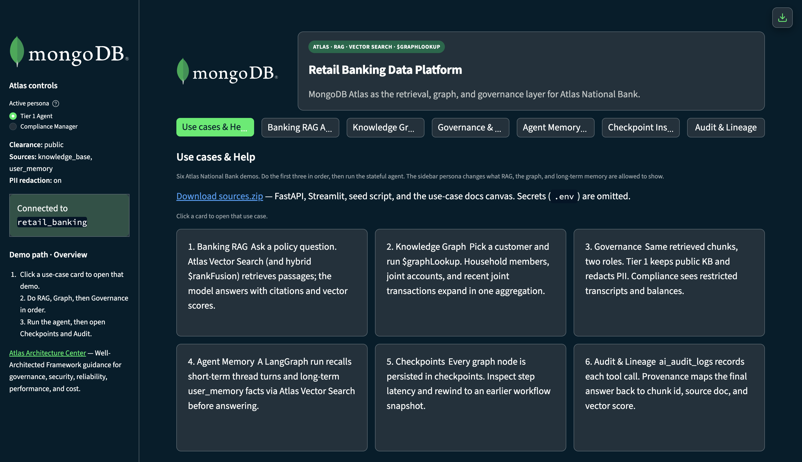
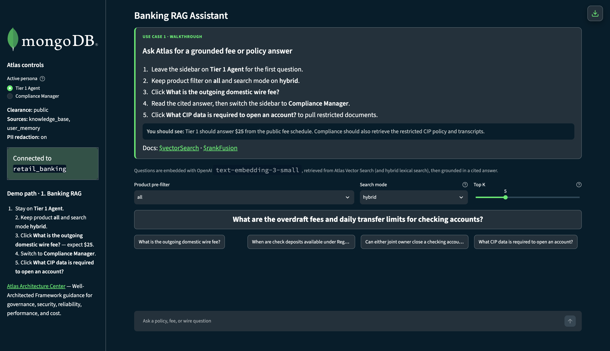
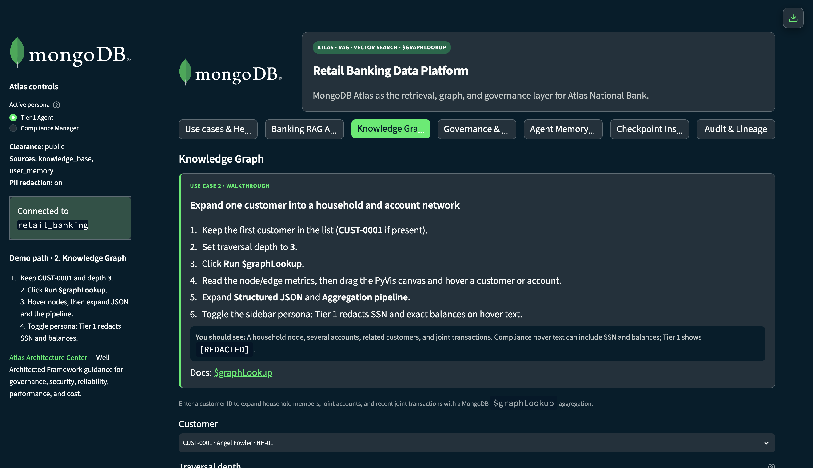
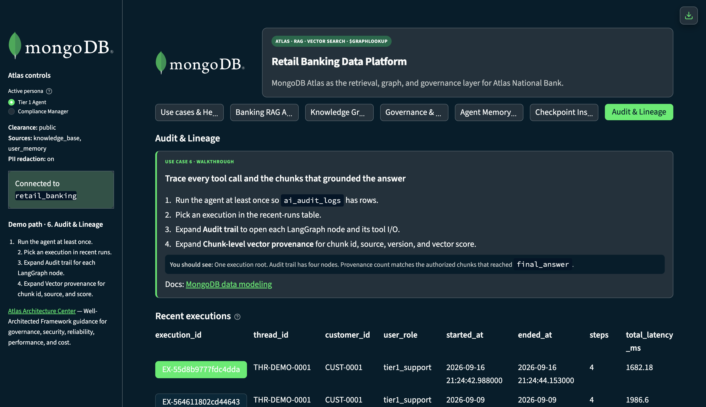

# RAGs to Riches — Atlas National Bank demo

FastAPI + Streamlit retail-banking RAG on MongoDB Atlas: Vector Search, `$graphLookup`, role-based governance, LangGraph agent memory, checkpoints, and audit/lineage.

Live demo (when the EC2 host is up): https://54.147.137.184.sslip.io/

## Demo walkthrough

Playwright tour of the live UI — screenshots + video in [`docs/demo/`](docs/demo/):

[](docs/demo/walkthrough.mp4)

- Video: [walkthrough.mp4](docs/demo/walkthrough.mp4) · [walkthrough.webm](docs/demo/walkthrough.webm)
- Gallery + re-record script: [docs/demo/README.md](docs/demo/README.md)

<p>
  
  
  
</p>

## What's in this repo

| Path | Purpose |
|---|---|
| `app/` | FastAPI services — Vector Search, graph, security, agent, audit |
| `ui/` | Streamlit dashboard (MongoDB-branded) |
| `app/scripts/seed_data.py` | Seed customers, accounts, policies, memories |
| `docs/` | Walkthroughs, Cursor canvases, Ally Financial access report |
| `requirements.txt` | Python dependencies |

## Quick start

```bash
python3.12 -m venv .venv
source .venv/bin/activate
pip install -r requirements.txt
cp .env.example .env   # set MONGODB_URI and OPENAI_API_KEY
python -m app.scripts.seed_data
uvicorn app.main:app --reload --port 8000
# separate terminal
streamlit run ui/app.py
```

## Docs

- [Ally Financial access report](docs/ally-financial-access.md) — nginx analysis of Ally egress (`198.74.88.193`) on the demo host
- Cursor canvases (open in Cursor):
  - `docs/canvases/atlas-banking-rag-docs.canvas.tsx`
  - `docs/canvases/ally-financial-access.canvas.tsx`
  - `docs/canvases/ec2-access-ips.canvas.tsx`

## Use cases in the UI

1. Banking RAG Assistant — hybrid / vector search with citations  
2. Knowledge Graph — `$graphLookup` household expansion  
3. Governance & Security — role filters + PII redaction  
4. Agent Memory & State — LangGraph short/long-term memory  
5. Checkpoint Inspector — rewind workflow snapshots  
6. Audit & Lineage — hierarchical execution → audit trail → chunk provenance tree  

## Environment

See `.env.example`. Do not commit real `.env` files. Atlas Network Access must allow your client IP.
